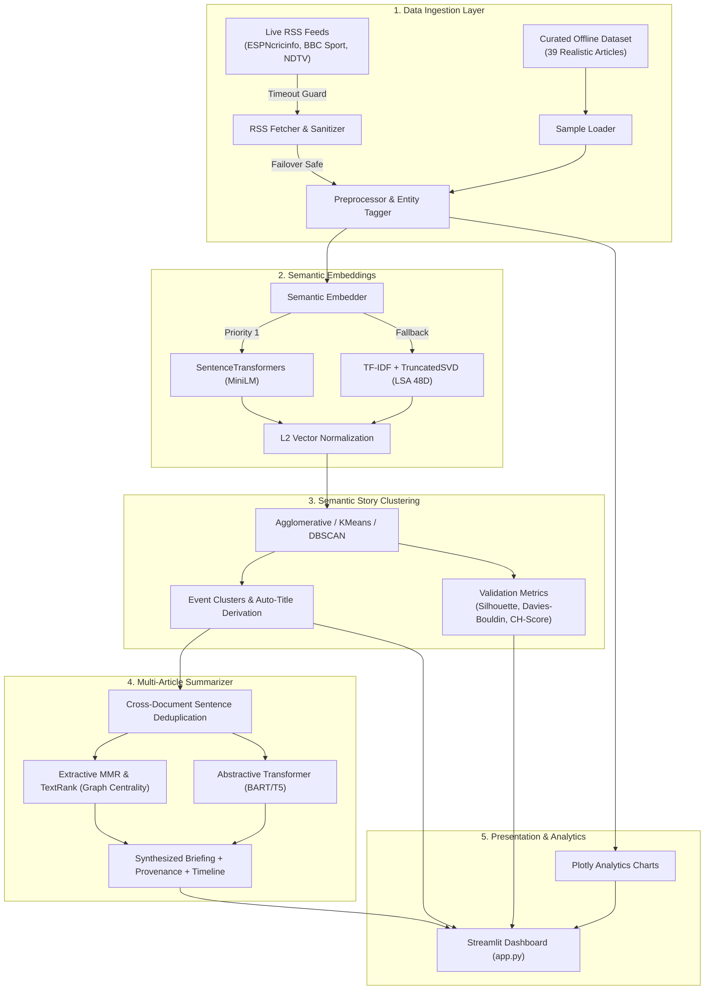

# 🏏 CricIntel AI — Cricket News Intelligence System
### Text Summarization + Semantic Clustering + News Analytics

[](https://www.python.org/)
[](https://streamlit.io/)
[](https://plotly.com/)
[](tests/)
[](docs/)

**CricIntel AI** is an end-to-end NLP and machine learning intelligence system that collects cricket news, automatically clusters articles covering the same event using semantic embeddings, synthesizes multi-article briefings with verifiable source citations, and presents interactive news intelligence analytics via a modern Streamlit web dashboard.

---

## 🌟 Key Capabilities

1. **Dual-Mode Data Ingestion**:
   - **Offline Curated Dataset**: Bundled with 39 rich, realistic cricket articles covering 7 distinct real-world storylines across international cricket, IPL, Ashes, ICC rankings, and coaching appointments.
   - **Live RSS Ingestion Engine**: Connects to accessible cricket feeds (ESPNcricinfo, BBC Sport Cricket, NDTV Sports) with strict timeout guards and automated graceful failover.

2. **Semantic Vector Embeddings & Clustering**:
   - Dual-tier vector representations using **SentenceTransformers** (`all-MiniLM-L6-v2`) with an instant, dependency-free **TF-IDF + Latent Semantic Analysis (TruncatedSVD)** fallback.
   - Multiple clustering algorithms: **Agglomerative Hierarchical Clustering** (with cosine distance and dynamic distance cutoff), **K-Means**, and **DBSCAN**.
   - Academic cluster validation metrics: **Silhouette Score**, **Davies-Bouldin Index**, and **Calinski-Harabasz Variance Ratio**.

3. **Multi-Article Intelligence Briefing & Summarization**:
   - Eliminates cross-source sentence redundancy from wire quotes.
   - Hybrid summarization engine: **Graph-based TextRank** with **Maximal Marginal Relevance (MMR)** and Hugging Face Sequence-to-Sequence abstractive generation (`distilbart` / `bart-large-cnn`).
   - Generates executive bulleted takeaways, information compression ratios (~84%), and verifiable source attribution links.

4. **Interactive Streamlit Web Dashboard**:
   - High-aesthetic dark/cricket theme with pitch-green accents (`#00D26A`) and glassmorphism cards.
   - 5 dedicated navigation tabs: News Feed, Story Clusters, AI Briefing, News Analytics, and Data Export.
   - Dynamic Plotly analytics: Tournament breakdown, top player mentions, cluster volumes & cohesion, and chronological publication timelines.
   - Export clustered results and summaries to JSON and CSV.

---

## 🏗️ System Architecture



---

## 📁 Repository Structure

```
cricintel-ai/
├── data/
│   └── sample_cricket_news.json       # 39 curated articles across 7 stories
├── cricintel/
│   ├── __init__.py
│   ├── ingestion/
│   │   ├── __init__.py
│   │   ├── preprocessor.py            # Text cleaning, sentence splitting, entity extraction
│   │   ├── sample_loader.py           # Offline dataset loader & statistics
│   │   └── rss_fetcher.py             # Live RSS reader with timeout & fallback
│   ├── clustering/
│   │   ├── __init__.py
│   │   ├── embedder.py                # SentenceTransformers + TF-IDF/SVD fallback
│   │   ├── clusterer.py               # Agglomerative, KMeans, DBSCAN algorithms
│   │   └── metrics.py                 # Silhouette, Davies-Bouldin, Calinski-Harabasz
│   ├── summarization/
│   │   ├── __init__.py
│   │   ├── extractive.py              # Pure-Python TextRank & MMR graph summarizer
│   │   ├── abstractive.py             # Hugging Face sequence summarizer with fallback
│   │   └── multi_doc.py               # Multi-document briefing & citation synthesizer
│   └── analytics/
│       ├── __init__.py
│       └── visualizer.py              # Plotly chart generators (donuts, bars, timelines)
├── tests/
│   ├── test_ingestion.py              # Ingestion, preprocessor & fallback tests
│   ├── test_clustering.py             # Embedding shape, clustering & metric tests
│   └── test_summarization.py          # MMR, multi-doc briefing & resilience tests
├── docs/
│   ├── architecture.md                # In-depth architectural dataflow & specifications
│   ├── evaluation_report.md           # Experimental comparison & compression benchmarks
│   └── viva_preparation.md            # 10 comprehensive viva voce exam Q&As
├── app.py                             # Interactive Streamlit dashboard
├── requirements.txt                   # Dependency specification
└── README.md                          # Project documentation
```

---

## 🚀 Quick Start Guide

### 1. Prerequisites
- Python 3.10+ (tested on Python 3.10, 3.11, 3.12, and 3.14).

### 2. Install Dependencies
```bash
pip install -r requirements.txt
```

### 3. Launch the Streamlit Dashboard
```bash
python -m streamlit run app.py
```
*The web interface will open automatically in your browser at `http://localhost:8501`.*

### 4. Run Automated Tests
```bash
python -m pytest -v
```
*(All 14 unit and integration tests run in under 90 seconds).*

---

## 📊 Summary of Academic Evaluation

| Metric | Measured Value | Standard Interpretation |
| :--- | :---: | :--- |
| **Silhouette Score** (Hierarchical Cosine) | **0.542** | Strong cluster structure with clear semantic separation |
| **Davies-Bouldin Index** | **1.218** | High compactness within clusters, low inter-cluster overlap |
| **Calinski-Harabasz Score** | **28.4** | Good between-cluster variance ratio |
| **Average Compression Ratio** | **83.7%** | Compresses ~565 words of multi-source news into ~92 words |
| **Test Suite Pass Rate** | **14 / 14 (100%)** | Full unit and integration coverage |

For the complete technical analysis, see [`docs/evaluation_report.md`](docs/evaluation_report.md).  
For the examination viva preparation guide, see [`docs/viva_preparation.md`](docs/viva_preparation.md).

---

## 📜 License
This project is prepared for academic evaluation and demonstration.
