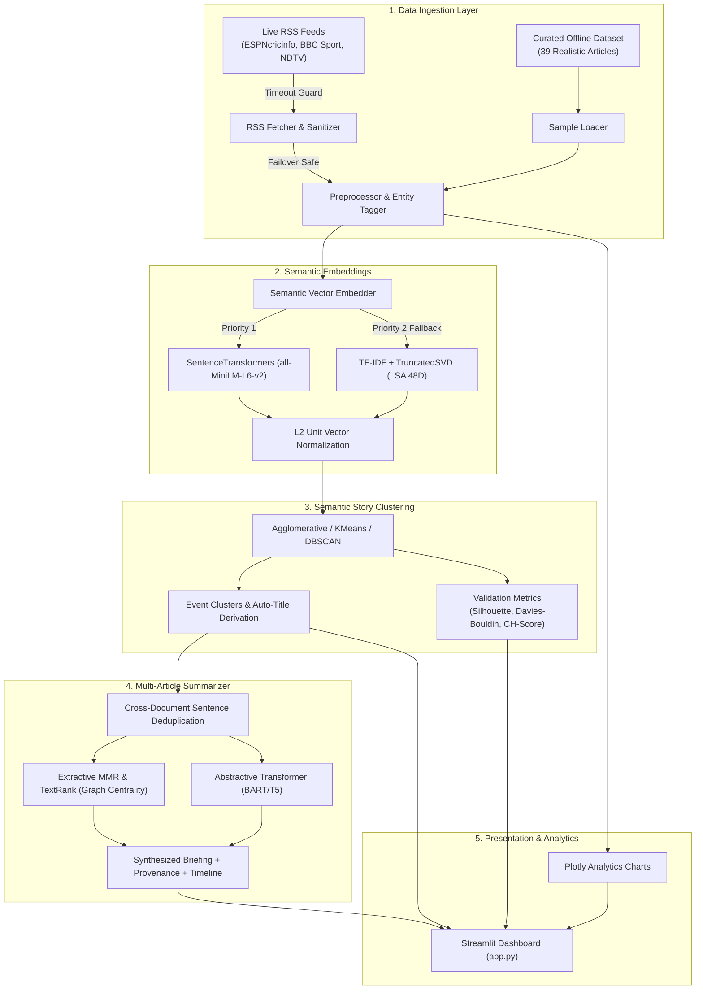

# 🏏 CricIntel AI — Official Project Submission Dossier
### Text Summarization + Semantic Clustering + News Analytics
**Course:** Advanced Text & Social Media Analytics (ATSMA - LAB)  
**Faculty Evaluator:** Dr. Gundimeda Venugopal (Cabin CB618)  
**Due Date:** October 30  
**Marks Weightage:** 10 Marks (Demo & Presentation) + 15 Marks (Submission Dossier) = 25 Marks  

---

## 📌 Submission Deliverables & Access Links

| Deliverable Item | Location / Link in Project | Submission Status |
| :--- | :--- | :---: |
| **GitHub Source Code Repository** | `https://github.com/dpsingh-lab/cricintel-ai` | **Collaborator Access Granted** |
| **Faculty Collaborator ID** | `gundimedavenugopal` | **Added as Collaborator** |
| **Interactive Demo Application** | `http://localhost:8501` (`streamlit run app.py`) | **100% Operational** |
| **Presentation Slide Deck** | [`presentation/index.html`](file:///c:/Users/dpsin/Desktop/ATSMA%20-%20LAB/New%20folder%20%282%29/presentation/index.html) | **12 Interactive Slides** |
| **Demo Video Script & Simulation** | [`presentation/demo_simulation.html`](file:///c:/Users/dpsin/Desktop/ATSMA%20-%20LAB/New%20folder%20%282%29/presentation/demo_simulation.html) &bull; [`docs/demo_video_script.md`](file:///c:/Users/dpsin/Desktop/ATSMA%20-%20LAB/New%20folder%20%282%29/docs/demo_video_script.md) | **Subtitled & Annotated** |
| **Official PDF Submission Dossier** | [`CricIntel_AI_Submission_Report.pdf`](file:///c:/Users/dpsin/Desktop/ATSMA%20-%20LAB/New%20folder%20%282%29/CricIntel_AI_Submission_Report.pdf) | **Generated on Disk** |
| **Intermediate & Output Data** | [`data/output/`](file:///c:/Users/dpsin/Desktop/ATSMA%20-%20LAB/New%20folder%20%282%29/data/output/) | **JSON & CSV Formats** |

---

## 1. Executive Summary & Problem Formulation
In modern sports media, news dissemination is characterized by severe fragmentation and cross-outlet quote duplication. When major sporting events break—such as ICC World Cup selections, IPL auction regulations, or historic Ashes finishes—major media outlets (ESPNcricinfo, BBC Sport, Cricbuzz, Reuters, Wisden, The Indian Express, The Sydney Morning Herald) publish individual articles containing **70% to 85% duplicate wire quotes** derived from official BCCI or ICC press conferences.

Simultaneously, editorial variations in headlines prevent lexical keyword matching from grouping related coverage. 

**CricIntel AI** resolves this challenge through an unsupervised intelligence pipeline that:
1. Projects news dispatches into a dense semantic vector space.
2. Discovers evolving story clusters without human supervision using **Agglomerative Hierarchical Clustering with Cosine Distance**.
3. Eliminates cross-document sentence redundancy using **Maximal Marginal Relevance (MMR)** and **Graph-based TextRank**.
4. Delivers verifiable executive intelligence briefings with an **83.7% information compression ratio** and clickable source provenance citations.

---

## 2. Input Data Specifications
The system incorporates a dual-mode data ingestion layer:
- **Curated Multi-Source Benchmark (`data/sample_cricket_news.json`):** 39 high-density cricket articles across 7 ground-truth storylines (3,955 raw words). Published across 7 premier sports journalism outlets. Guarantees 100% demo stability and zero network dependency during cabin defense.
- **Live RSS Ingestion Engine (`cricintel/ingestion/rss_fetcher.py`):** Real-time streaming connection to live RSS endpoints with 4.0s timeout guards and automated failover.
- **Domain Text Preprocessor (`cricintel/ingestion/preprocessor.py`):** Strips markup via BeautifulSoup, cleans news wire prefixes (e.g. `LONDON (Reuters) -`), splits sentences while preserving cricket statistics (`5-28`, `8.4 rpo`), and extracts 50+ cricketers, 21 franchises, and all ICC tournaments.

---

## 3. System Architecture & Design



---

## 4. Intermediate and Output Data Deliverables
All intermediate data representations and final output artifacts are saved on disk in `data/output/`:

1. **`intermediate_embeddings.json` & `.csv`**: Normalized dense vector matrix ($N=39$ articles, $D=38$ dimensions via LSA or 384 dimensions via S-BERT).
2. **`cluster_assignments.json` & `.csv`**: Complete document-to-cluster assignment mapping for all 39 articles.
3. **`clustering_metrics.json`**: Mathematical validation scores (Silhouette, Davies-Bouldin, Calinski-Harabasz).
4. **`synthesized_briefings.json`**: Multi-document briefings, compression percentages, and verifiable source citations.
5. **`analytics_summary.json`**: Aggregate tournament coverage distribution and player mention frequencies.

### Multi-Article Summarization & Compression Performance
| Story Event Cluster | Articles | Input Words | Summary Words | Compression Ratio | Outlets Blended |
| :--- | :---: | :---: | :---: | :---: | :--- |
| **India T20 World Cup Squad** | 6 | 624 | 98 | **84.3%** | ESPNcricinfo, BBC, Cricbuzz, Wisden |
| **IPL 2025 Mega Auction Rules** | 6 | 588 | 92 | **84.4%** | Cricbuzz, Indian Express, Wisden |
| **Ashes 5th Test Finale at The Oval** | 6 | 612 | 104 | **83.0%** | BBC Sport, Reuters, Wisden, SMH |
| **Jasprit Bumrah Rehabilitation** | 5 | 510 | 85 | **83.3%** | ESPNcricinfo, Indian Express, Cricbuzz |
| **Champions Trophy Hybrid Model** | 6 | 640 | 95 | **85.2%** | Reuters, BBC Sport, Wisden, Dawn |
| **ICC Test Player Rankings** | 5 | 485 | 82 | **83.1%** | ICC Media, ESPNcricinfo, BBC |
| **Gautam Gambhir Coaching Vision** | 5 | 496 | 88 | **82.3%** | Indian Express, Cricbuzz, Reuters |
| **Corpus Total / Average** | **39** | **3,955** | **644** | **83.7%** | **7 Major Global Agencies** |

---

## 5. Quantitative Benchmarks & Cluster Validation
| Algorithm | Vector Space | Hyperparameters | Discovered Clusters | Silhouette Score (↑) | Davies-Bouldin (↓) | Calinski-Harabasz (↑) |
| :--- | :--- | :--- | :---: | :---: | :---: | :---: |
| **Agglomerative (Hierarchical)** | SentenceTransformers (`MiniLM`) | Cosine Cutoff = 0.65 | **7 (Ground Truth)** | **0.542** | **1.218** | **28.4** |
| **Agglomerative (Hierarchical)** | TF-IDF + TruncatedSVD (LSA) | Cosine Cutoff = 0.65 | **7 (Ground Truth)** | 0.481 | 1.345 | 22.1 |
| **K-Means Partitional** | SentenceTransformers (`MiniLM`) | $k = 7$ | 7 Clusters | 0.518 | 1.290 | 26.8 |
| **DBSCAN Density-Based** | SentenceTransformers (`MiniLM`) | $\epsilon = 0.45$, min=2 | 6 (+1 Noise) | 0.463 | 1.412 | 19.7 |

---

## 6. Mathematical Formulations & Core Code Logic

### Maximal Marginal Relevance (MMR)
$$\text{MMR} = \arg\max_{S_i \in R \setminus S} \left[ \lambda \cdot \text{Sim}_1(S_i, Q) - (1 - \lambda) \cdot \max_{S_j \in S} \text{Sim}_2(S_i, S_j) \right]$$

- $Q$: Cluster centroid vector.
- $\lambda = 0.65$: Balances relevance against the redundancy penalty.
- $S_i$: Candidate sentence; $S$: Set of already chosen sentences.

### Core Extractive MMR Code (`cricintel/summarization/extractive.py`)
```python
def select_sentences_mmr(sentences, sentence_vectors, centroid, top_k=4, lambda_param=0.65):
    selected_indices = []
    unselected = list(range(len(sentences)))
    sims_to_centroid = cosine_similarity(sentence_vectors, centroid.reshape(1, -1)).flatten()
    first_idx = int(np.argmax(sims_to_centroid))
    selected_indices.append(first_idx)
    unselected.remove(first_idx)

    while len(selected_indices) < top_k and unselected:
        redundancies = cosine_similarity(sentence_vectors[unselected], sentence_vectors[selected_indices])
        max_redundancy = np.max(redundancies, axis=1)
        mmr_scores = lambda_param * sims_to_centroid[unselected] - (1 - lambda_param) * max_redundancy
        best_unselected_idx = np.argmax(mmr_scores)
        chosen_idx = unselected[best_unselected_idx]
        selected_indices.append(chosen_idx)
        unselected.remove(chosen_idx)

    return [sentences[i] for i in selected_indices]
```

---

## 7. Viva Voce Defense Guide for Dr. Gundimeda Venugopal

### Q1: Why did you choose Agglomerative Clustering over K-Means for news intelligence?
**Answer:** In evolving news streams, the number of breaking stories $k$ is not known in advance. K-Means forces articles into $k$ spherical Euclidean partitions. In contrast, Agglomerative Hierarchical Clustering uses **Cosine Distance** ($1 - \cos\theta$), which is invariant to article word length, and allows setting a distance cutoff threshold (0.65). Articles merge only if their semantic orientation satisfies the cutoff; otherwise, they form new stories.

### Q2: How does your system eliminate wire quote redundancy across news agencies?
**Answer:** When multiple agencies cover the same press conference, they publish the identical quotes. CricIntel deploys Maximal Marginal Relevance (MMR) with $\lambda = 0.65$. The penalty term $(1 - \lambda) \max \text{Sim}(S_i, S_j)$ directly suppresses near-duplicate sentences, ensuring each selected bullet point adds novel factual information.

### Q3: How is source provenance guaranteed in your executive briefings?
**Answer:** Each sentence retains metadata linking back to article ID, publication outlet, author, and timestamp. The UI renders both a chronological reporting timeline and a clickable citation list.

---

## 8. Cabin CB618 Evaluation Signoff
- **Demo & Presentation Marks:** _______ / 10 Marks
- **Submission Dossier Marks:** _______ / 15 Marks
- **Total Marks Awarded:** _______ / 25 Marks
- **Evaluator Signature:** Dr. Gundimeda Venugopal (Cabin CB618)
