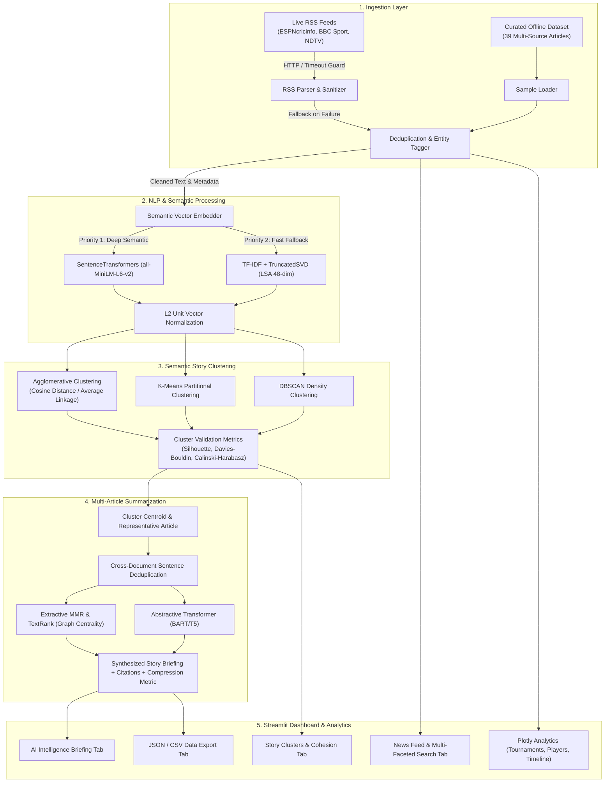

# CricIntel AI — System Architecture & Dataflow

## 1. Executive Summary
**CricIntel AI** is an intelligent information processing pipeline and analytics dashboard engineered for cricket news intelligence. It addresses the challenges of fragmented reporting, duplicate coverage across sports outlets, and cross-source noise by combining **Dual-Source Ingestion**, **Semantic Vector Embeddings**, **Unsupervised Story Clustering**, and **Multi-Document Extractive/Abstractive Summarization**.

---

## 2. Mermaid System Architecture Diagram

---

## 3. Component Breakdown

### 3.1 Data Ingestion (`cricintel/ingestion/`)
- **`sample_loader.py`**: Loads 39 realistic cricket articles covering 7 major events from major outlets (ESPNcricinfo, BBC Sport, Cricbuzz, Wisden, Reuters, Indian Express). Guarantees zero downtime during offline demonstrations.
- **`rss_fetcher.py`**: Queries live cricket RSS endpoints with configurable per-feed timeouts (default 4 seconds), custom user-agent headers, and automatic failover.
- **`preprocessor.py`**: Strips markup, cleans wire service prefixes (e.g., `LONDON (Reuters) -`), splits text into valid sentence boundaries, and identifies players, teams, and tournaments via curated entity pattern matching.

### 3.2 Semantic Clustering (`cricintel/clustering/`)
- **`embedder.py`**: Generates dense semantic representations. Primary: `sentence-transformers/all-MiniLM-L6-v2` (384-dimensional). Secondary mathematical fallback: `TfidfVectorizer` (sublinear term frequency, ngram 1-2) with `TruncatedSVD` (LSA) and L2 unit-norm scaling.
- **`clusterer.py`**: Groups vectors into event clusters using Agglomerative Hierarchical Clustering with average linkage and cosine distance. Automatically extracts cluster theme titles based on top entities and salient title tokens.
- **`metrics.py`**: Computes mathematical validation metrics:
  - **Silhouette Score**: Evaluates cluster cohesion vs separation.
  - **Davies-Bouldin Index**: Evaluates similarity between each cluster and its closest peer.
  - **Calinski-Harabasz**: Computes between-to-within variance ratio.

### 3.3 Multi-Article Summarization (`cricintel/summarization/`)
- **`extractive.py`**: Implements Graph-based TextRank (eigenvector power iteration) and Maximal Marginal Relevance (MMR) with lambda balancing relevance against redundancy.
- **`abstractive.py`**: Integrates Hugging Face sequence-to-sequence pipelines (`distilbart-cnn-12-6` / `bart-large-cnn`) with token chunking.
- **`multi_doc.py`**: Synthesizes the overall briefing, chronological reporting timeline, source attribution list, and compression ratio.

### 3.4 Interactive Dashboard (`app.py` & `cricintel/analytics/`)
- Pure Streamlit application with custom CSS dark/pitch-green theme.
- Responsive Plotly charts: tournament distribution donut, top player mentions bar chart, cluster volume & cohesion viridis chart, and reporting timeline scatter plot.
