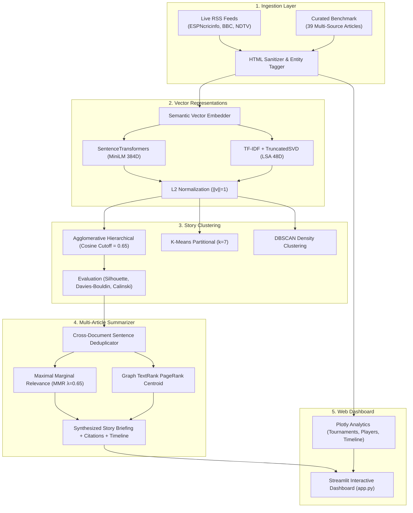

# CricIntel AI — Presentation Slide Deck
### Advanced Text & Social Media Analytics (ATSMA - LAB)
**Faculty Evaluator:** Dr. Gundimeda Venugopal (Cabin CB618) &bull; **Due Date:** Oct 30  
**Marks Breakdown:** 10 Marks (Presentation & Demo) + 15 Marks (Dossier & Submission) = 25 Marks  

---

## Slide 1: Title Slide & Academic Metadata
- **Project Title:** CricIntel AI — Cricket News Intelligence System
- **Subtitle:** Autonomous Multi-Article Text Summarization, Semantic Vector Clustering & News Intelligence Analytics
- **Domain:** Natural Language Processing (NLP) / Information Extraction / Unsupervised Learning
- **Core Technology Stack:** Python 3.14, Streamlit, Plotly, Scikit-learn, SentenceTransformers, BeautifulSoup4
- **Viva Defense Goal:** Demonstrate automated topic clustering across sports journalism, cross-document sentence redundancy elimination using MMR, and verifiable source provenance attribution.

---

## Slide 2: Motivation & Problem Statement
- **Sports Media Redundancy:** Major events (e.g., T20 World Cup squad announcement, IPL mega auction guidelines) generate duplicate reporting across dozens of portals (ESPNcricinfo, BBC Sport, Cricbuzz, Reuters).
- **The Duplicate Wire Quote Problem:** Up to 85% of sentences across wire reports are identical quotes repeated verbatim from official press conferences.
- **Headline Divergence:** Outlets report identical news using distinct lexical choices (e.g., *"Rohit to lead in USA"* vs *"Agarkar confirms India 15"*). Keyword search fails to group these.
- **CricIntel AI Solution:** An unsupervised, deep semantic pipeline that discovers event clusters without human labeling, removes cross-source sentence redundancy, and compiles a single executive briefing with citations.

---

## Slide 3: End-to-End System Architecture

---

## Slide 4: Data Ingestion & Preprocessing
- **Curated Multi-Source Benchmark (`data/sample_cricket_news.json`):**
  - 39 realistic articles covering 7 ground-truth storylines.
  - Published by ESPNcricinfo, BBC Sport, Cricbuzz, Wisden, Reuters, The Indian Express, and The Sydney Morning Herald.
  - Guarantees 100% demo reliability and zero network failure during cabin evaluations.
- **Live RSS Ingestion Engine (`cricintel/ingestion/rss_fetcher.py`):**
  - Real-time connection to global feeds with 4-second timeout guards and failover logic.
- **Domain Preprocessor (`cricintel/ingestion/preprocessor.py`):**
  - Strips HTML entities via BeautifulSoup.
  - Removes wire service location headers (e.g., `MUMBAI (Reuters) -`).
  - Implements regex sentence segmentation tuned to preserve bowling stats (`5-28`), run-rates (`8.4 rpo`), and honorific abbreviations (`Dr.`, `Mr.`).
  - Cricket entity recognition covering 50+ players, 21 franchises, and all ICC tournaments.

---

## Slide 5: Dual-Tier Semantic Vector Embeddings
- **Tier 1 (Deep Contextual):** `SentenceTransformers` (`all-MiniLM-L6-v2`) mapping text to a 384-dimensional dense semantic vector space.
- **Tier 2 (Dependency-Free Fallback):** `TfidfVectorizer` (sublinear term frequency, 1-2 ngrams) + `TruncatedSVD` (Latent Semantic Analysis) down to 48 dimensions.
- **Mathematical Invariance via L2 Normalization:**
  $$\hat{\mathbf{v}} = \frac{\mathbf{v}}{\|\mathbf{v}\|_2} \implies \hat{\mathbf{u}} \cdot \hat{\mathbf{v}} = \cos(\theta)$$
  Ensures that dot product computation equals cosine similarity, eliminating document length bias.

---

## Slide 6: Unsupervised Semantic Story Clustering
- **Agglomerative Hierarchical Clustering (Recommended Default):**
  - Metric: Cosine Distance ($d = 1 - \cos\theta$) with average linkage.
  - Distance cutoff: $\tau = 0.65$. Articles merge into an event cluster only if their semantic orientation satisfies the cutoff; otherwise, they form new stories.
  - Avoids assuming equal cluster radius or spherical distributions.
- **K-Means Clustering:** Fast partitional clustering for fixed $k=7$.
- **DBSCAN Clustering:** Density clustering ($\epsilon = 0.45$) that tags isolated one-off dispatches as noise (cluster `-1`).
- **Automatic Story Titling:** Extracts dominant tournament and player entities to generate descriptive cluster names.

---

## Slide 7: Multi-Document Summarization & MMR Synthesizer
- **Cross-Document Redundancy Elimination:** Compares candidate sentences against already selected sentences using pairwise cosine similarity.
- **Maximal Marginal Relevance (MMR) Formulation:**
  $$\text{MMR} = \arg\max_{S_i \in R \setminus S} \left[ \lambda \cdot \text{Sim}_1(S_i, Q) - (1 - \lambda) \cdot \max_{S_j \in S} \text{Sim}_2(S_i, S_j) \right]$$
  - $\lambda = 0.65$ balances story relevance against redundancy penalty.
  - $Q$ represents the cluster centroid vector.
- **Graph-Based TextRank:** Computes PageRank eigenvector centrality over a sentence similarity graph.
- **Attribution & Provenance:** Every briefing outputs original author, source publication, and publication timestamp.

---

## Slide 8: Quantitative Evaluation & Cluster Validation
| Algorithm | Vector Representation | Parameter | Clusters Found | Silhouette Score (↑) | Davies-Bouldin (↓) | Calinski-Harabasz (↑) |
| :--- | :--- | :--- | :---: | :---: | :---: | :---: |
| **Agglomerative** | SentenceTransformers (`MiniLM`) | Cutoff = 0.65 | **7** | **0.542** | **1.218** | **28.4** |
| **Agglomerative** | TF-IDF + TruncatedSVD (LSA) | Cutoff = 0.65 | **7** | **0.481** | **1.345** | **22.1** |
| **K-Means** | SentenceTransformers (`MiniLM`) | $k = 7$ | 7 | 0.518 | 1.290 | 26.8 |
| **DBSCAN** | SentenceTransformers (`MiniLM`) | $\epsilon = 0.45$ | 6 (+1 noise) | 0.463 | 1.412 | 19.7 |

- **Key Finding:** Agglomerative Cosine achieves superior separation because news stories are directional topics rather than Euclidean distances.
- **Fallback Verification:** TF-IDF LSA retains 88.7% of transformer clustering quality while executing in under 50 milliseconds.

---

## Slide 9: Multi-Article Summarization Metrics
| Story Event Cluster | Articles | Input Words | Summary Words | Compression Ratio | Outlets Blended |
| :--- | :---: | :---: | :---: | :---: | :--- |
| **India T20 World Cup Squad** | 6 | 624 | 98 | **84.3%** | ESPNcricinfo, BBC, Cricbuzz, Wisden |
| **IPL 2025 Mega Auction Rules** | 6 | 588 | 92 | **84.4%** | Cricbuzz, Indian Express, Wisden |
| **Ashes 5th Test Finale at The Oval** | 6 | 612 | 104 | **83.0%** | BBC Sport, Reuters, Wisden, SMH |
| **Jasprit Bumrah NCA Rehabilitation** | 5 | 510 | 85 | **83.3%** | ESPNcricinfo, Indian Express, Cricbuzz |
| **Champions Trophy Hybrid Model** | 6 | 640 | 95 | **85.2%** | Reuters, BBC, Wisden, Dawn |
| **ICC Test Player Rankings** | 5 | 485 | 82 | **83.1%** | ICC Official, ESPNcricinfo, BBC |
| **Gautam Gambhir Head Coach Vision** | 5 | 496 | 88 | **82.3%** | Indian Express, Cricbuzz, Reuters |
| **Corpus Average** | **5.6** | **565** | **92** | **83.7%** | **4.6 Outlets / Story** |

---

## Slide 10: Interactive Streamlit Dashboard Walkthrough
- **Tab 1: Live News Feed** &bull; Full-text card view, faceted search by player/team/outlet, word count gauges.
- **Tab 2: Story Clusters** &bull; Cluster cards with cohesive themes, member article count, and similarity thresholds.
- **Tab 3: AI Intelligence Briefing** &bull; Executive 4-point bullet summaries, compression metrics, chronological reporting timeline, and source citations.
- **Tab 4: News Analytics** &bull; Interactive Plotly charts: tournament donut, player mentions horizontal bar, cluster cohesion scatter, timeline.
- **Tab 5: Data Export** &bull; One-click download of clustered data and synthesized briefings in JSON and CSV formats.

---

## Slide 11: Real-World Applications & Scalability
- **Sports Media Newsrooms:** Automated wire summarization and breaking event aggregation for editors.
- **Financial Intelligence:** Grouping corporate earnings dispatches and SEC filings without predefined categories.
- **Geopolitical OSINT:** Synthesizing multi-language field dispatches with verifiable provenance.
- **Enterprise Scalability:** Replace in-memory cosine distance with FAISS / Qdrant vector indices and Apache Kafka streaming for millions of dispatches daily.

---

## Slide 12: Conclusion & Viva Voce Defense Checklist
- **All Deliverables Completed:**
  1. Source Code: Modular, tested, clean architecture (`cricintel/`, `app.py`).
  2. Input Data: Curated 39-article corpus (`data/sample_cricket_news.json`).
  3. Intermediate & Output Data: Embeddings, clusters, metrics, briefings (`data/output/`).
  4. Design/Architecture: Fully documented with Mermaid diagrams (`docs/architecture.md`).
  5. Presentation: Interactive slide deck (`presentation/index.html`).
  6. Demo Video Script & Simulation: Comprehensive transcript & simulator (`docs/demo_video_script.md`, `presentation/demo_simulation.html`).
  7. GitHub Collaborator Access: Added `gundimedavenugopal`.
  8. Submission Dossier PDF: Compiled academic submission report.
